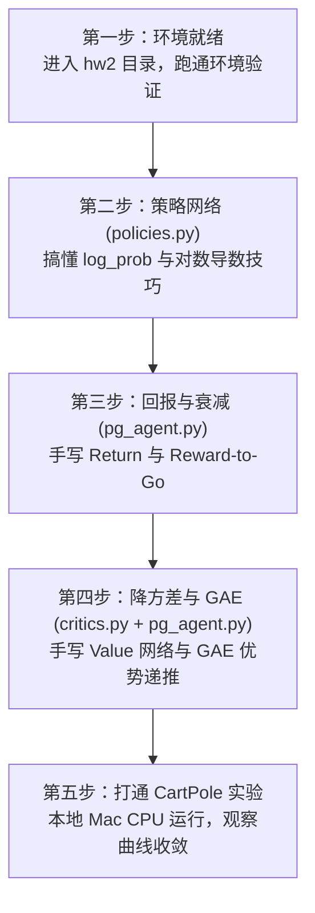

# Week 3：强化学习数学基础 + 策略梯度（Policy Gradients & PPO）

> 本周主线以 **Berkeley CS285 HW2（Policy Gradients）** 为实战核心，彻底打通强化学习数学基础（MDP、对数导数技巧、Reward-to-Go、Baseline、GAE、PPO/GRPO）。
> 所有代码在本地 Mac CPU 上即可极速调试与训练，无需昂贵 GPU 算力。

---

## 一、 仓库目录全景导航

`Week 3 - RL 数学基础 + PPO/` 目录下收录了 Berkeley CS285（深度强化学习名课）的完整配套作业体系，各子目录职责如下：

```text
Week 3 - RL 数学基础 + PPO/
├── README.md                      # [当前文档] 本周主线学习指南与通关路线
└── CS285-Homework/                # CS285 官方作业代码库
    ├── hw1/                       # 作业 1：模仿学习（通用 uv 环境配置与 Modal 指南）
    │   └── README.md
    ├── hw2/                       # ★【本周唯一核心】作业 2：策略梯度（Policy Gradients）
    │   ├── README.md              # 作业 2 运行与调试说明
    │   ├── pyproject.toml         # 依赖配置（gym, torch, numpy 等）
    │   └── src/
    │       ├── agents/
    │       │   └── pg_agent.py    # ★ 策略梯度智能体核心逻辑（计算 Q 值、GAE 优势估计、网络更新）
    │       ├── networks/
    │       │   ├── policies.py    # ★ 策略网络（MLPPolicyPG：动作分布、策略损失计算）
    │       │   └── critics.py     # ★ 价值网络（ValueCritic：前向预测与 MSE 损失）
    │       ├── infrastructure/    # 采样、日志、设备辅助工具（无需修改）
    │       └── scripts/
    │           └── run.py         # 实验运行入口脚本
    ├── hw3/                       # 作业 3：Q-Learning (DQN) 与 SAC（作为拓展参考）
    ├── hw4/                       # 作业 4：LLM RL（Week 4 主线：大语言模型 GRPO / REINFORCE）
    ├── hw5/                       # 作业 5：离线强化学习（Offline RL）
    ├── final_project_llm_rl/      # 期末项目：基于 Qwen2.5-1.5B 的 RLHF / DPO / GRPO 实战
    └── final_project_offline_online/ # 期末项目：离线到在线强化学习
```

---

## 二、 应该先看什么、再看什么？（最佳学习路径）

不要迷失在几十个文件夹里！本周你的**唯一目标是攻克 `CS285-Homework/hw2`**，按以下 4 步走最快：



### 第 1 步：环境准备（5 分钟）
打开终端，直接进入 `hw2` 目录：
```bash
cd "/Users/elon2ge/workspace/Agent算法作业/Week 3 - RL 数学基础 + PPO/CS285-Homework/hw2"
uv sync
```
若提示缺少 swig，Mac 用户执行 `brew install swig cmake`。

### 第 2 步：读懂并填写 `src/networks/policies.py`（约 25 行代码）
* **看什么**：
  * 看 `MLPPolicy.forward`：离散动作空间用 `torch.distributions.Categorical`，连续动作空间用 `torch.distributions.Normal`。
  * 看 `MLPPolicyPG.update`：损失函数公式为 $\mathcal{L}(\theta) = - \frac{1}{N} \sum (\log \pi_\theta(a|s) \cdot A)$。
* **为什么先看它**：
  * 因为强化学习与监督学习唯一的不同，就是把 Cross-Entropy 换成了 `-(log_prob * advantage)`！

### 第 3 步：读懂并填写 `src/agents/pg_agent.py` 前半部分（约 20 行代码）
* **看什么**：
  * `_discounted_return`：整条轨迹累加回报 $G = \sum_{t=0}^T \gamma^t r_t$。
  * `_discounted_reward_to_go`：从当前步往后累加的未来回报 $G_t = \sum_{t'=t}^T \gamma^{t'-t} r_{t'}$（因果性降方差）。
* **验证效果**：
  此时就可以直接在本地跑基础版的 REINFORCE 实验：
  ```bash
  uv run src/scripts/run.py --env_name CartPole-v0 -n 100 -b 1000 --exp_name cartpole_basic
  ```

### 第 4 步：读懂并填写 `src/networks/critics.py` 与 GAE（约 30 行代码）
* **看什么**：
  * `critics.py`：价值网络就是个普通的回归模型，目标是用 MSE 损失去拟合 $Q$ 值。
  * `pg_agent.py` 中的 `_estimate_advantage`：
    * 减去 Baseline：$A = Q - V$。
    * GAE 递推：从后向前逆推 $\delta_t = r_t + \gamma V_{t+1} - V_t$，然后 $A_t = \delta_t + \gamma \lambda A_{t+1}$。
* **验证效果**：
  加上 `--use_baseline` 重新运行，观察方差如何显著降低，曲线如何稳定收敛到 200 分满分！
  ```bash
  uv run src/scripts/run.py --env_name CartPole-v0 -n 100 -b 1000 -rtg --use_baseline --exp_name cartpole_gae
  ```

---

## 三、 本周通关后，对你的 Agent 算法有何提升？

当你把这 80 行代码在本地填完，你在 Week 4 接触大模型强化学习（CS285 HW4 & GRPO）时会发现：
1. **大模型的 Token 采样** = `policies.py` 里的 `Categorical.sample()`；
2. **大模型生成答案的 Loss** = `-(log_prob * advantage)`；
3. **GRPO 的优势估计** = 去掉 `critics.py`，直接对采样的一组轨迹计算标准化得分 $\frac{R - \text{mean}}{\text{std}}$。

你脑海里的离散概念将全部串联成一条完整的算法珍珠项链！
